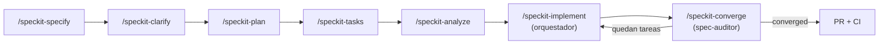

# Mascota Nexus

Aplicación de adopción con backend Java 17 / Spring Boot en `backend/`, frontend React en `frontend/` y PostgreSQL como base de datos.

## Arnés de Copilot

El repositorio está configurado para GitHub Copilot en VS Code y usa [Spec Kit](https://github.com/github/spec-kit) (CLI `specify` 1.4.3, integración `copilot`, scripts PowerShell) para el desarrollo guiado por especificaciones.

| Pieza | Dónde está | Para qué sirve |
|---|---|---|
| Constitución | `.specify/memory/constitution.md` | Principios no negociables del proyecto. Todas las fases de Spec Kit la leen y prevalece sobre cualquier otra instrucción. |
| Memoria | `.github/copilot-instructions.md`, `backend/AGENTS.md`, `frontend/AGENTS.md` | Lo que Copilot lee al iniciar cada sesión: enlaza la constitución, describe el flujo SDD, las reglas y los comandos. |
| Instrucciones por tipo de archivo | `.github/instructions/*.instructions.md` | Reglas que solo se aplican a `backend/**/*.java` o a `frontend/src/**/*.js` (`applyTo`). |
| Skills de Spec Kit | `.github/skills/speckit-*` | Los comandos del flujo SDD: `/speckit-specify`, `/speckit-clarify`, `/speckit-plan`, `/speckit-tasks`, `/speckit-analyze`, `/speckit-implement`, `/speckit-converge`, `/speckit-checklist` y `/speckit-constitution`. |
| Skills propias | `.github/skills/` (tabla siguiente) | Procedimientos de Mascota Nexus que los agentes cargan cuando la tarea lo necesita. |
| Agentes | `.github/agents/*.agent.md` | Roles con modelo, herramientas y skills propios, a los que delega `/speckit-implement`. |
| Preset de Spec Kit | `speckit-custom/presets/implement-orquestador/` | Convierte `/speckit-implement` en un orquestador que no escribe código y delega cada tarea en un agente. |
| Plantillas, scripts y workflow de Spec Kit | `.specify/templates/`, `.specify/scripts/powershell/`, `.specify/workflows/` | Generan la estructura de cada spec (`specs/NNN-nombre/`). |
| Calidad | `.github/workflows/quality.yml` | Pruebas, cobertura con umbral y E2E en cada pull request. |

Los módulos también conservan instrucciones y skills complementarias en `backend/.github/` y `frontend/.github/`.

### Skills y asignación a agentes

| Skill | Ubicación | Problema que resuelve | Cuándo se invoca | Agentes que la usan |
|---|---|---|---|---|
| `spring-service-testing` | `.github/skills/` | Pruebas de servicios, controladores, repositorios y reglas de negocio del backend. | Al cambiar o probar código Java del backend. | `backend-implementer`, `quality-reviewer` |
| `react-accessible-flows` | `.github/skills/` | Flujos React accesibles, pruebas de interfaz, identidad del usuario y estados asíncronos. | Al cambiar componentes o pruebas de `frontend/src/`. | `frontend-implementer`, `quality-reviewer` |
| `adoption-flow-validation` | `.github/skills/` | Validación de postulaciones, persistencia, transiciones de estado y resultados visibles para el adoptante, incluidas las pruebas Playwright. | Al cambiar datos de la solicitud, reglas de envío, historial o decisiones del administrador. | `backend-implementer`, `frontend-implementer`, `quality-reviewer` |
| `java-spring-best-practices` | `backend/.github/skills/` | Arquitectura por capas, DTOs y manejo de errores en servicios Spring. | Al abrir `backend/` como espacio de trabajo propio. | Complementaria, no asignada en el frontmatter de los agentes. |
| `web-design-guidelines` | `frontend/.github/skills/` | Accesibilidad, diseño responsive y patrones Tailwind de la interfaz. | Al abrir `frontend/` como espacio de trabajo propio. | Complementaria, no asignada en el frontmatter de los agentes. |

La asignación de skills a agentes está declarada en el campo `skills:` de cada archivo de `.github/agents/`. Las dos últimas skills son complementarias y están disponibles junto a las instrucciones de cada módulo.

### Agentes y herramientas permitidas

| Agente | Responsabilidad | Modelo | Herramientas |
|---|---|---|---|
| `backend-implementer` | Implementar y probar backend respetando controller/service/repository. | `GPT-4.1` | `read`, `search`, `edit`, `execute` |
| `frontend-implementer` | Implementar flujos React accesibles, API y pruebas de interacción. | `GPT-4.1` | `read`, `search`, `edit`, `execute` |
| `quality-reviewer` | Revisar ambos módulos y ejecutar verificaciones sin herramienta de edición de archivos. | `GPT-4.1` | `read`, `search`, `execute` |
| `spec-auditor` | Ejecutar `/speckit-converge` al terminar la implementación y añadir a `tasks.md` lo que falte. | `GPT-4.1` | `read`, `search`, `edit`, `execute` |

Las listas de herramientas limitan las herramientas disponibles para cada agente; el agente de calidad no tiene la herramienta `edit`. La ejecución de comandos no equivale a un aislamiento del sistema operativo.

Dentro de `/speckit-implement`, el orquestador delega cada bloque de tareas en el agente de su módulo, pide la revisión a `quality-reviewer` en cada historia y la convergencia a `spec-auditor` al final. Los agentes no se invocan entre sí y responden con un informe fijo (`ESTADO`, `TAREAS`, `ARCHIVOS`, `EVIDENCIA`, `NECESITA DE OTRO AGENTE`, `PREGUNTAS PARA LA DESARROLLADORA`).

### Cómo se usa el arnés

Cada funcionalidad nueva sigue el flujo SDD de Spec Kit, de principio a fin, en Copilot Chat (modo agente). Los comandos se ejecutan de uno en uno y se revisa el resultado de cada uno antes del siguiente.



1. **Rama:** `git switch -c NNN-nombre-corto` desde `main` actualizado.
2. **`/speckit-specify <descripción>`:** genera `specs/NNN-nombre/spec.md` (historias de usuario, requisitos y criterios de aceptación) y `checklists/requirements.md`.
3. **`/speckit-clarify`:** resuelve las ambigüedades de la spec con preguntas.
4. **`/speckit-plan Sigue la constitución; no introduzcas tecnologías nuevas.`:** genera `plan.md` (con el *Constitution Check*), `research.md`, `data-model.md`, `contracts/` y `quickstart.md`.
5. **`/speckit-tasks`:** genera `tasks.md`, con la tarea de prueba antes de la de implementación.
6. **`/speckit-analyze`:** comprueba la consistencia entre spec, plan y tareas.
7. **`/speckit-implement`:** el orquestador delega en `backend-implementer` y `frontend-implementer` (Red → Green), revisa con `quality-reviewer` y termina con `spec-auditor`.
8. **`/speckit-converge`:** si el orquestador no lo ejecutó, compruébalo a mano; debe terminar en `converged`.
9. **Pull request:** Conventional Commits, push de la rama y PR hacia `main`; el CI (`quality.yml`) debe quedar en verde antes de fusionar.
   ```powershell
   git add specs/NNN-nombre backend frontend
   git commit -m "feat: describe la funcionalidad"
   git push -u origin NNN-nombre-corto
   ```

## Desarrollo guiado por especificaciones

### Specs 001 a 005 (antes de Spec Kit)

Estas cinco specs se escribieron a mano con la estructura propia `spec → plan → tasks`, antes de instalar Spec Kit. Sus carpetas se renombraron de `NN-` a `NNN-` para que la numeración de Spec Kit continúe en la 006.

| Spec | Funcionalidad | Pull request fusionado |
|---|---|---|
| `specs/001-filtrado-mascotas/` | Filtrar mascotas disponibles por especie y edad máxima. | [#1](https://github.com/Lala5411/Mascotas-Nexus/pull/1) |
| `specs/002-busqueda-catalogo/` | Buscar y filtrar en el catálogo. | [#2](https://github.com/Lala5411/Mascotas-Nexus/pull/2) |
| `specs/003-historial-solicitudes/` | Guardar y consultar postulaciones del usuario. | [#3](https://github.com/Lala5411/Mascotas-Nexus/pull/3) |
| `specs/004-validacion-solicitudes/` | Validar postulaciones e invariantes de adopción. | [#4](https://github.com/Lala5411/Mascotas-Nexus/pull/4) |
| `specs/005-transiciones-solicitudes/` | Aprobar o rechazar solicitudes pendientes de forma segura. | [#5](https://github.com/Lala5411/Mascotas-Nexus/pull/5) |

### Specs 006 a 010 (flujo SDD con Spec Kit)

Estas specs se desarrollan de principio a fin con el flujo SDD de Spec Kit y los agentes del arnés. Cada una tiene, en su carpeta, `spec.md`, `checklists/`, `plan.md`, `research.md`, `data-model.md`, `contracts/`, `quickstart.md` y `tasks.md`.

| Spec | Funcionalidad | Estado | Pull request |
|---|---|---|---|
| `specs/006-…` | El adoptante cancela una solicitud pendiente. | Pendiente | — |
| `specs/007-…` | Validación del registro de mascotas. | Pendiente | — |
| `specs/008-…` | Resumen de solicitudes por estado para el administrador. | Pendiente | — |
| `specs/009-…` | Ordenar el catálogo por nombre o edad. | Pendiente | — |
| `specs/010-…` | Impedir eliminar una mascota con solicitudes pendientes. | Pendiente | — |

## Mecanismos de calidad

El workflow `.github/workflows/quality.yml` ejecuta:

- Pruebas de backend contra PostgreSQL y JaCoCo; la cobertura global debe alcanzar al menos 60% de instrucciones y 60% de ramas.
- Pruebas frontend con Jest y compilación de producción; los umbrales globales son 60% de sentencias, 60% de ramas, 55% de funciones y 60% de líneas.
- Pruebas de extremo a extremo con Playwright (`frontend/e2e/`, configuración en `frontend/playwright.config.js`) contra una base PostgreSQL aislada `mascota_nexus_e2e`; se ejecutan localmente con `npm run test:e2e` desde `frontend/`.
- Artefactos de cobertura de backend y frontend, y el informe `playwright-report`, retenidos durante siete días en las ejecuciones de CI.

Las pruebas backend están en [`backend/src/test/java/`](./backend/src/test/java/) y las pruebas frontend junto a los componentes en [`frontend/src/components/`](./frontend/src/components/). Los informes locales se generan en [`backend/target/site/jacoco/`](./backend/target/site/jacoco/) al ejecutar `.\mvnw.cmd verify` y [`frontend/coverage/`](./frontend/coverage/) al ejecutar Jest con `--coverage`. Son salidas generadas y no están versionadas. El workflow [quality.yml](./.github/workflows/quality.yml) publica esos directorios como artefactos `backend-coverage` y `frontend-coverage`.

El historial de PRs incluye [#1](https://github.com/Lala5411/Mascotas-Nexus/pull/1), [#2](https://github.com/Lala5411/Mascotas-Nexus/pull/2), [#3](https://github.com/Lala5411/Mascotas-Nexus/pull/3), [#4](https://github.com/Lala5411/Mascotas-Nexus/pull/4) y [#5](https://github.com/Lala5411/Mascotas-Nexus/pull/5). Esos enlaces son evidencia de integración; no sustituyen los informes de cobertura o los resultados de CI.

## Cambios respecto del taller

El diseño de partida es el del *Taller 5: Sistema de agentes*: siete agentes (`orquestador-mascotas`, `auditor-contrato-api`, `backend-test-author`, `backend-implementer`, `frontend-test-author`, `frontend-implementer` y `guardian-calidad`), modelo Copilot Fusion y mutation testing (PIT y StrykerJS) como puerta de calidad. Lo implementado son los cuatro agentes de `.github/agents/` más el orquestador como preset de `/speckit-implement`. Cada cambio se apoya en lo que muestra el historial de los PR o en lo que observamos al revisar el proyecto.

| Qué cambió | Qué observamos al ejecutar las specs y por qué |
|---|---|
| Se eliminó `orquestador-mascotas`. | Cuatro de las cinco specs tocaron un solo módulo: #1, #4 y #5 solo `backend/`, y #2 solo `frontend/`. Solo la spec 03 tocó ambos. Un orquestador repartiendo trabajo entre carriles no tenía casi nada que coordinar; la integración la controlan el PR y el CI. |
| Se eliminó `auditor-contrato-api`. | Como el contrato HTTP solo cruzó módulos en la spec 03, se sustituyó la auditoría por evidencia ejecutable: pruebas HTTP con MockMvc (`SolicitudControllerHttpTest`) y pruebas Playwright que llaman al backend real. Una discrepancia de contrato hace fallar esas pruebas en CI. |
| `backend-test-author` y `frontend-test-author` se fusionaron con los implementadores. | En los PR #1, #2, #4 y #5 las pruebas y el código llegaron en un solo commit: la separación Red/Green entre dos agentes no se practicó. Cada implementador escribe sus pruebas, y el CI y el revisor comprueban que existan y pasen. |
| `guardian-calidad` pasó a ser `quality-reviewer`, con las mismas herramientas (`read`, `search`, `execute`, sin `edit`). | Se mantuvo la decisión central del taller: el revisor ejecuta y reporta, pero no se autocorrige. Se quitó la clasificación de mutantes porque no hay mutation testing (fila siguiente). |
| El mutation testing (PIT y StrykerJS) se reemplazó por umbrales de cobertura medidos (JaCoCo y Jest) y pruebas E2E con Playwright, todo en `quality.yml`. | El taller registraba que no existía ningún workflow de CI. Se priorizó una puerta automática en cada PR: en el PR #3 detectó un fallo de `npm ci` que no se veía en local. Limitación reconocida, igual que en el taller: la cobertura mide ejecución, no la calidad de las aserciones. |
| Se añadieron skills y la asignación `skills:` en cada agente. | El diseño del taller no tenía skills. Las specs 03 a 05 repitieron el mismo flujo de solicitudes en ambos módulos, y de ahí salió `adoption-flow-validation`. |
| El modelo pasó de Copilot Fusion (Standard) a `GPT-4.1`. | No fue una decisión de diseño: el agente de Copilot escribió `GPT-4.1` al añadir el campo `model` durante el cierre del proyecto, y lo aceptamos sin evaluarlo contra Copilot Fusion. Lo declaramos como una diferencia no justificada; compararlos queda pendiente. |
| Se instaló Spec Kit y se recuperó el orquestador del taller como preset de `/speckit-implement`; se añadió `spec-auditor`. | En la revisión del proyecto, el profesor señaló que lo que teníamos no era un arnés porque el flujo SDD no se ejecutaba: las specs 001 a 005 eran Markdown escritos a mano y ningún comando ni agente los generaba. Con Spec Kit el flujo `specify → plan → tasks → implement → converge` es ejecutable, y el orquestador que diseñamos en el taller vuelve como el rol de `/speckit-implement`, delegando en los agentes. `spec-auditor` cumple el papel de verificación que en el taller tenía `auditor-contrato-api`, ahora contra la spec completa. |
| Los agentes se crearon a partir de la spec 03. | Las specs 01 y 02 se planearon con `/plan` en el chat (`backend/plan-1-grupo8.md`, `frontend/plan-2-grupo8.md`); los archivos `.github/agents/` aparecen por primera vez en el PR #3. |

## Ejecución local

Inicia PostgreSQL según la configuración de `backend/src/main/resources/application.properties`. Luego ejecuta el backend:

```powershell
cd backend
.\mvnw.cmd spring-boot:run
```

En otra terminal, inicia el frontend:

```powershell
cd frontend
npm start
```

Ejecuta los controles desde el directorio de cada módulo:

```powershell
# backend
.\mvnw.cmd test

# frontend
npm test -- --watchAll=false
npm test -- --watchAll=false --coverage
npm run build
```
